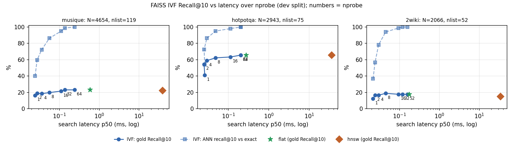

# M3 — Hybrid retrieval: BM25 + FAISS IVF + fusion + cross-encoder rerank

Branch: `m3-hybrid-rerank`, from `advait-feature-1`. Done-when (spec): *ablation rows 2 and 4 are filled; the IVF curve is plotted.*

## What was built

| Piece | File | Notes |
| --- | --- | --- |
| BM25 | `apex/index/bm25.py` | `rank_bm25` Okapi, k1 = 1.2, b = 0.75. Lowercase `\w+` tokens, small English stopword list, no stemming (exact names, numbers and codes are what BM25 is for). IDF over the whole collection; a scoped query (one paper or story) masks scores to that document |
| FAISS IVF | `apex/index/ivf.py` | `IndexIVFFlat`, inner product on L2-normalised vectors (= cosine). Built from the **Chroma embeddings**, keyed by the same node ids; Chroma stays the source of truth. Deterministic k-means (fixed seed, single thread) |
| Fusion | `apex/retrieve/fusion.py` | RRF (k = 60) and weighted min-max fusion; ties broken by node id |
| Reranker | `apex/retrieve/rerank.py` | `BAAI/bge-reranker-v2-m3` pinned to HF commit `953dc6f`, CPU via `transformers`, `local_files_only` (a missing model is a loud error; fetch with `scripts/fetch_reranker.py`). Scores cached in SQLite by content hash |
| Hybrid retriever | `apex/retrieve/hybrid.py` | `retrieval.mode`: `dense` (unchanged M1 Chroma HNSW), `dense_ivf`, `bm25`, `hybrid`. 50 candidates per retriever → fused top 20 → optional rerank. Per-stage scores, ranks and latencies go into each trace |
| Retrieval-only eval | `apex/eval/retrieval_bench.py` | `suite retrieval` (several configs, same questions, minutes) and `suite ivf-curve` |
| Configs | `configs/ablations/row2_hybrid.yaml`, `row4_rerank.yaml`, `fusion_rrf.yaml` | |

Tests: `tests/unit/test_hybrid_indexes.py`, `tests/integration/test_hybrid_pipeline.py`.

## Fast plan (owner decision, 13 Nov 2026)

- **Answer metrics** (generation) run on the **first 100 test questions per dataset** (custom: all 32), 532 questions per row. The first 100 keep the full set's mix: 4–11 unanswerables per dataset, and MuSiQue hops 56/26/18, against 139/65/46 of 250.
- **Paired comparisons** against the M2 baseline use the same 100 ids, which the baseline already has.
- **Retrieval metrics** are on the full 250 test questions (no LLM involved).
- **All tuning is on dev, retrieval-only.**

## Tuning on dev (retrieval-only)

### Retrievers on their own (`results/m3_retrieval_dev`)

Dev Recall@10, about 45 answerable questions per dataset:

| Dataset | Dense HNSW (M1) | Dense IVF | BM25 | Hybrid RRF | Hybrid weighted 0.5/0.5 |
| --- | --- | --- | --- | --- | --- |
| QASPER | 90.4 | 90.4 | 82.8 | 94.8 | 92.6 |
| MuSiQue | 22.4 | 21.7 | **61.5** | 45.9 | 53.9 |
| HotpotQA | 65.6 | 63.3 | **92.2** | 78.9 | 88.9 |
| 2Wiki | 15.0 | 17.8 | **68.3** | 55.6 | 62.2 |

**The headline: on multi-hop, BM25 alone beats dense retrieval by 27–53 points.** These questions name their bridge entities exactly ("Who was born first, X or Y?"), and nomic-embed-text misses them. Equal-weight fusion lets the weak dense list pull BM25 down. On QASPER (paraphrase-heavy, scoped to one paper) hybrid beats both.

### Fusion sweep (`results/m3_fusion_dev`)

| Dev Recall@10 | QASPER | MuSiQue | HotpotQA | 2Wiki | MRR (mean of 4) |
| --- | --- | --- | --- | --- | --- |
| RRF k = 20 / 60 / 100 | 94.8 / 94.8 / 94.8 | 50.6 / 45.9 / 45.9 | 84.4 / 78.9 / 78.9 | 62.8 / 55.6 / 55.6 | 59.9 / 57.6 / 57.6 |
| weighted, BM25 weight 0.5 | 92.6 | 53.9 | 88.9 | 62.2 | 69.7 |
| weighted, BM25 weight 0.6 | 94.8 | 57.2 | 93.3 | 66.7 | 75.4 |
| **weighted, BM25 weight 0.7** | **97.0** | 58.3 | 94.4 | 68.3 | **76.9** |
| weighted, BM25 weight 0.8 | 94.8 | 61.1 | 95.6 | 69.4 | 76.1 |
| BM25 only | 82.8 | 61.5 | 92.2 | 68.3 | 75.1 |

**Row 2 uses weighted fusion with dense 0.3 / BM25 0.7.** It is the best balance: the highest QASPER recall and the best mean MRR, close to BM25 on multi-hop, and Recall@20 (the reranker's candidate pool) of 98.9 / 65.9 / 97.8 / 71.1. With about 45 questions per dataset, the 0.7 vs 0.8 difference is within noise.

### IVF: Recall@10 vs latency (`results/m3_ivf_curve_dev/ivf_curve.png`)

- **nlist:** 119 (MuSiQue), 75 (HotpotQA), 52 (2Wiki); see deviation 1.
- **ANN recall@10** is the overlap with the exact top 10. It reaches 94.9–98.7% at nprobe 16 and **98.7–99.8% at nprobe 32**, where search takes about 0.1–0.2 ms. Gold Recall@10 at nprobe 32 equals exact search on all three. **nprobe = 32** is set in `base.yaml`.
- **HNSW** (Chroma) reaches the same recall at about 35–40 ms. Most of that is the Chroma client (Python, SQLite metadata filter), not the HNSW graph, so it is a systems number, not an index-vs-index comparison.
- **At this corpus size (2–5k vectors) even exact search takes under 0.6 ms.** IVF's speed advantage only matters at a scale we don't have; the curve shows IVF's recall cost, which is negligible at nprobe ≥ 32.

### Reranker speed on this CPU

`bge-reranker-v2-m3` is a 568M-parameter XLM-R large. The timings below score 20 passages for one query on the laptop CPU:

| Setting | HotpotQA (median 127 tokens/pair) | QASPER (median 264) |
| --- | --- | --- |
| fp32, batch 4 | 14–15 s | 22.5 s |
| fp32, batch 20 | 29 s | — |
| bf16 autocast | 329 s | — |
| **int8 dynamic quantization, batch 1** | **6.9 s** | **8.6 s** |

On both probes, int8 kept the same top-5 set as fp32. `rerank.quantize: int8, batch_size: 1` is the default. This still adds about 7–9 s per question.

### Parallel generation: rejected

`OLLAMA_NUM_PARALLEL=2` was tested on 16 fresh dev questions per arm (scratch run, not committed).
- **Throughput gain was only about 1.25×** (13.6 vs 17.1 s per question). A first measurement of 2.36× was an artifact of a concurrent model download.
- **Outputs were not reproducible:** two identical parallel runs disagreed on 1 of 16 answers, and parallel vs sequential differed on 6 of 16, including abstain flips.

That violates the reproducibility rule, so generation stays one request at a time.

## Deviations and [PROPOSED] choices to flag

1. **`nlist` is capped at N / 39.** The spec's starting point of 4·√N would need ≥ 39·nlist training vectors, more than our corpora have (for MuSiQue: 273 cells needs 10,647 vectors, but N = 4,654). k-means trains on all vectors. At ≥ 1M vectors the formula gives 4·√N again.
2. **Indexes are built in memory from Chroma** when a retriever is constructed (≈ 1 s on our largest corpus), not persisted. They are always consistent with the store. Persisting them only becomes worthwhile when build time does.
3. **Row 2 fuses with dev-tuned weighted fusion (0.3 dense / 0.7 BM25), not RRF.** The spec marks RRF as [PROPOSED] and weighted fusion as its ablation. On dev, RRF was 3–15 points worse on multi-hop recall, so the roles are swapped. RRF stays as the fusion ablation (`fusion_rrf.yaml`, retrieval metrics on full test).
4. **The generator gets the top 5 in every M3 row,** the same as the M2 baseline, so rows differ only in ranking and the comparison is budget-matched. The spec's "rerank keeps top 8 for the evidence filter" takes effect when the filter exists (M5).
5. **M3's row 4 has no RAPTOR tree;** the tree is row 3 and comes in M4. After M4, the cumulative row 4 (tree + reranker) is re-run.
6. **The reranker runs with int8 dynamic quantization on the CPU** (above). fp32 would add 15–25 s per question.
7. **Scoped queries** (QASPER, QuALITY: one document) use exact dense search over that document's vectors, not IVF. An ANN index has nothing to do over a few dozen vectors.
8. **BM25 gives a term in at least half the documents an IDF ≤ 0**, as Okapi defines it; results with a total score ≤ 0 are dropped. Irrelevant at our corpus sizes, but visible on toy corpora.

## Results: test

### Retrieval only, full test split (`results/m3_retrieval_test`)

All answerable questions with gold evidence (QASPER 234, MuSiQue/HotpotQA/2Wiki 225, custom 27). No LLM involved.

| Recall@10 (MRR) | Naive (M1/M2, Chroma HNSW) | Dense IVF | BM25 | Hybrid RRF k = 60 | **Row 2: weighted 0.3/0.7** |
| --- | --- | --- | --- | --- | --- |
| QASPER | 88.5 (52.6) | 88.5 (52.6) | 79.3 (40.9) | 88.3 (50.4) | **89.5** (45.7) |
| MuSiQue | 26.5 (34.4) | 27.3 (35.3) | 52.6 (72.7) | 45.1 (46.8) | **55.6** (70.9) |
| HotpotQA | 56.7 (54.1) | 56.4 (54.1) | 89.3 (87.6) | 80.0 (74.8) | **90.4** (89.2) |
| 2Wiki | 16.9 (18.1) | 17.8 (20.1) | **72.6** (94.6) | 60.2 (47.1) | 71.2 (93.6) |
| custom | 21.6 (10.8) | 21.6 (10.8) | **40.1** (22.4) | 38.3 (21.4) | 37.0 (25.2) |

- **The dev choices hold on test.** Weighted fusion beats RRF by 10–11 Recall@10 points on all three multi-hop sets.
- **IVF vs HNSW:** the same recall, within 1 point on every dataset. Retriever p50 is about 2 ms for IVF against about 85–100 ms through Chroma. This run overlapped the row 2 generation run, so absolute latencies are inflated, but both arms were.
- **Negative result, QASPER ranking:** row 2's MRR falls from 52.6 to 45.7 while recall rises 1 point. The 0.7 BM25 weight pushes paraphrased evidence down inside a long paper. Row 4's reranker is the intended fix.

### Row 2: hybrid retrieval, answers (`results/m3_row2_hybrid_test100`)

Paired against the M2 baseline on the same question ids (`compare_vs_m2.md`). The change and its 95% bootstrap CI are in points; p is the two-sided paired-bootstrap p, with the Wilcoxon signed-rank p after the slash.

| Dataset | n | F1 M2 → row 2 | Δ F1 | p (bootstrap / Wilcoxon) | Δ Recall@10 | Δ answer in context | Δ prompt tokens |
| --- | --- | --- | --- | --- | --- | --- | --- |
| QASPER | 100 | 44.5 → 42.3 | −2.2 (−8.7, +3.9) | 0.49 / 0.74 | −0.5 | −2.3 | +73 |
| MuSiQue | 100 | 15.6 → 27.4 | **+11.8** (+5.4, +18.5) | 0.001 / 0.002 | +31.1 | +11.4 | −108 |
| QuALITY | 100 | 44.4 → 45.6 | +1.2 (−6.8, +9.5) | 0.78 / 0.64 | — | — | +3 |
| HotpotQA | 100 | 41.5 → 58.8 | **+17.3** (+8.2, +26.7) | < 0.001 / 0.001 | +31.3 | +14.1 | −137 |
| 2Wiki | 100 | 24.1 → 33.8 | **+9.6** (+1.0, +18.6) | 0.03 / 0.05 | +50.6 | +38.9 | −332 |
| custom | 32 | 36.3 → 41.2 | +5.0 (+0.2, +10.9) | 0.04 / 0.19 | +15.4 | — | +49 |

QuALITY multiple-choice accuracy is 65.0 in both. There were no generation failures. The 2Wiki gain is borderline on Wilcoxon (0.05), and the custom gain does not survive it (0.19, n = 32).

**Reading:**
- Hybrid retrieval is a large, significant win on all three multi-hop sets, and it comes from retrieval: Recall@10 rises by 31–51 points, and the share of questions with the gold answer in the prompt rises by 11–39 points.
- Prompts get shorter there too, because the hybrid retriever picks short exact passages.
- On long single-document QA (QASPER, QuALITY) it is neutral within noise, with a small, non-significant QASPER drop that tracks the MRR drop above.

### Row 4: + cross-encoder rerank (`results/m3_row4_rerank_test100`)

Row 2's fused top 20 is reranked by bge-reranker-v2-m3 (int8 dynamic quantization, CPU, batch 1) and the generator gets the reranked top 5 (the same budget as rows 1 and 2). The questions and generator are the same as in row 2. Paired comparisons: `compare_vs_row2.md` (the reranker's own effect) and `compare_vs_m2.md` (the cumulative M3 effect). Δ values are in points, with 95% bootstrap CIs; p is bootstrap / Wilcoxon.

| Dataset | n | F1 M2 → row 2 → row 4 | Δ F1 vs row 2 | p vs row 2 | Δ F1 vs M2 | p vs M2 | Δ nDCG@10 vs row 2 | Δ answer in context vs row 2 |
| --- | --- | --- | --- | --- | --- | --- | --- | --- |
| QASPER | 100 | 44.5 → 42.3 → 50.0 | **+7.7** (+1.7, +14.1) | 0.012 / 0.021 | +5.5 (−2.4, +13.2) | 0.17 / 0.07 | +8.9 | +9.1 |
| MuSiQue | 100 | 15.6 → 27.4 → 27.4 | +0.0 (−8.6, +8.8) | 1.00 / 0.92 | **+11.8** (+3.2, +20.5) | 0.008 / 0.012 | +11.6 | +11.4 |
| QuALITY | 100 | 44.4 → 45.6 → 46.2 | +0.6 (−7.5, +8.8) | 0.88 / 0.85 | +1.8 (−7.0, +10.5) | 0.69 / 0.81 | — | — |
| HotpotQA | 100 | 41.5 → 58.8 → 65.9 | +7.1 (−1.8, +15.8) | 0.12 / 0.16 | **+24.4** (+13.6, +35.3) | < 0.001 / < 0.001 | +12.6 | +14.1 |
| 2Wiki | 100 | 24.1 → 33.8 → 32.2 | −1.6 (−9.6, +6.4) | 0.70 / 0.90 | +8.1 (−1.5, +17.9) | 0.10 / 0.10 | +5.5 | +5.6 |
| custom | 32 | 36.3 → 41.2 → 39.4 | −1.8 (−6.0, +1.9) | 0.39 / 0.69 | +3.1 (−2.5, +9.5) | 0.29 / 0.30 | +8.3 | — |

QuALITY multiple-choice accuracy goes 65.0 → 65.0 → 67.0, which is not significant. There were no generation failures.

Retrieval on these question sets, row 4 vs row 2:
- Recall@10: QASPER +0.4, MuSiQue +6.7, HotpotQA +5.5, 2Wiki +2.8, custom +10.5.
- nDCG@10 rises significantly (p < 0.001) on QASPER, MuSiQue, HotpotQA and 2Wiki.
- QASPER MRR is 55.1, back above the naive 52.6. This undoes the row 2 negative result.

Cost:
- Prompts are 37–159 tokens longer (except on QuALITY), because the reranker prefers longer passages.
- p50 latency goes from 11.6–22.3 s in row 2 to 17.9–38.2 s in row 4, about 6–16 s more per question. Scoring 20 pairs one at a time on the CPU is now the main cost after generation.
- Caveat: about the first 45 QASPER questions ran beside a second copy of this run plus a clustering job, so QASPER's p95 (64.8 s) is inflated. The other datasets ran alone.

**Reading:**
- The reranker does what it was added for. Ranking quality rises everywhere, and more questions get the gold answer into the prompt (+9 to +14 points on QASPER, MuSiQue and HotpotQA).
- That turns into a significant F1 gain only on QASPER (+7.7), the dataset where row 2's BM25-heavy fusion had hurt.
- On the multi-hop sets the better context does not show up in F1: MuSiQue +0.0, HotpotQA +7.1 (not significant), 2Wiki −1.6. The bottleneck there looks like the 7B generator's multi-hop composition rather than retrieval. That is what M7 targets.
- Cumulatively, M3 (row 4 vs M2) is significant on MuSiQue and HotpotQA. It is directional but not significant on QASPER, 2Wiki and custom. QuALITY is unchanged within noise, which is expected: its answers depend on reading a long story, which M4's summaries address.
- **int8 vs fp32 reranker** (`scripts/rerank_int8_check.py`, `results/m3_rerank_probe/int8_vs_fp32_dev20.json`): 20 dev questions, 5 each from QASPER, MuSiQue, HotpotQA and 2Wiki, each scoring row 2's fused top 20.
  - The top-1 passage is the same in 18 of 20.
  - The top-5 sets overlap by 4.7 of 5 on average and are identical in 14 of 20.
  - Spearman correlation is 0.96 on average (minimum 0.92).
  - int8 takes 5.7 s per question against 14.5 s for fp32, 2.5× faster.
  - int8 therefore changes about one of the five packed passages in 6 questions of 20. An fp32 row 4 would cost about 2.5× the rerank time and is not run.
